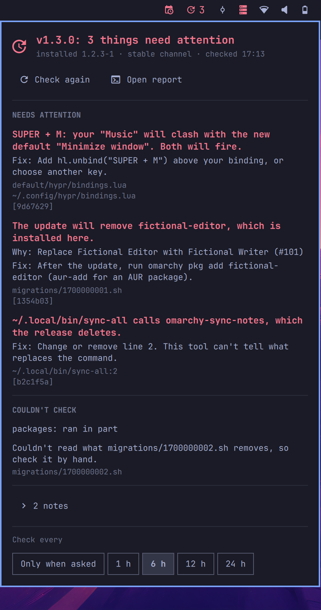

# omaupdateimpact

An Omarchy update can change your shortcuts, remove packages you use and delete
commands your scripts call. Release notes say what changed for everyone. They can't
say what it means for your machine, so you find out afterwards.

omaupdateimpact tells you before you update. This is its report for a made-up machine
on v4.0.6, looking at v4.5.0-rc2:

```
$ omaupdateimpact v4.5.0-rc2
Omarchy 4.0.6-1 -> v4.5.0-rc2 (rc channel, prerelease). Nothing was changed.
Checked 207 default bindings, 3 of yours, 27 pending migrations for packages and 28 for
file edits, 7 of your files for 6 deleted commands, 1 plugin linted.

Needs attention. Seen one, and it's fine? Run this again with --ack and its id.
  - ALT + ALT_R: your "Scratchpad" will clash with the new default "Start dictation
    (push-to-talk) / Stop dictation (push-to-talk)". Both will fire. [3344d3a]
    Fix: Add hl.unbind("ALT + Alt_R") above your binding, or choose another key.
  - SUPER + M: your "Music" will clash with the new default "Minimize window to the
    dock". Both will fire. [a9f00c7]
    Fix: Add hl.unbind("SUPER + M") above your binding, or choose another key.
  - SUPER + CTRL + T: you turned off "Activity" here, but it moves to SUPER + SHIFT + T,
    so it comes back. [372d010]
    Fix: Add hl.unbind("SUPER + SHIFT + T") too.
  - The update will remove dua-cli, which is installed here. [d09d6a6]
    Why: Replace the Disk Usage TUI with Disktree (#14426).
    Fix: After the update, run omarchy pkg add dua-cli (aur-add for an AUR package).
  - The update may remove t3code-bin, which is installed here. [8a98386]
    Fix: If it goes, run omarchy pkg add t3code-bin (aur-add for an AUR package).
  - The update will remove tensaku, which is installed here. [2787bde]
    Why: Replace Tensaku with Omasnap for screenshots (#9446).
    Fix: After the update, run omarchy pkg add tensaku (aur-add for an AUR package).
  - ~/.bashrc calls omarchy-voxtype-remove, which the release deletes. [a8db01f]
    Fix: Change or remove line 1. This tool can't tell what replaces the command.
  - ~/.config/omarchy/hooks/post-update calls omarchy-voxtype-status, which the release
    deletes. [6735a5a]
    Fix: Change or remove line 4. This tool can't tell what replaces the command.
  - ~/.config/systemd/user/nightly-backup.service calls omarchy-system-shutdown, which
    the release deletes. [a44914f]
    Fix: Change or remove line 7. This tool can't tell what replaces the command.
  - ~/.local/bin/end-of-day calls omarchy-system-reboot, which the release deletes.
    [fd9adc7]
    Fix: Change or remove line 4. This tool can't tell what replaces the command.

Worth knowing: 12 notes. Add --all to see them.

Limits of this check
  - Couldn't read what migrations/1785351479.sh removes, so check it by hand.

These checks ran in part: packages.
```

It changes nothing, and nothing from the release is ever run. Each finding says what
to do, and you do it.

omaupdateimpact is unofficial. It isn't affiliated with Omarchy or 37signals.

## Install

Needs Python 3.11.4 or newer, which Omarchy already has. `qmllint` is optional, and
comes with `qt6-declarative`.

There are two ways to install it, and each works on its own. The plugin puts an
icon in the bar and brings its own command. The terminal install puts the command
on your `PATH`, with an optional row in the Omarchy menu. You need only one.

### In the bar

The repository is an Omarchy shell plugin. It puts an icon in the bar that shows
the result, for when you'd rather not open a terminal:

```
omarchy plugin add https://github.com/Frestina/omaupdateimpact.git --enable
```



- The icon is faded when nothing needs attention, has a count in the warning colour
  when something does, and a `?` when it couldn't check. It never hides, and it is
  never shown as clear for a check that didn't run.
- Click it for the panel: what needs attention, then what couldn't be checked,
  then what is worth knowing, then what you reviewed. Each finding shows its title.
  Click anywhere on its row to see the rest, with the fix to copy. The arrow on the
  right turns when it opens. Worth knowing lists the notes by kind, such as
  "Shortcuts that move", each with its count. Open a kind to see its notes. A note
  that lists things, such as the new default shortcuts, shows one per line. "Check
  again" checks now.
  "Open report" shows the full report in a terminal.
- "Mark reviewed", under a finding that needs attention, is for one you've seen and
  accepted. It runs the command with `--ack` and that id at once, so the finding no
  longer counts for that release, and the count in the bar drops. The finding moves
  to Reviewed at the bottom, where "Undo" runs `--unack` and it counts again.
  Reviews are kept in `~/.config/omaupdateimpact/reviewed`, and the panel names
  that file.
- "Ask agent", under any finding, hands it to your default coding agent through
  Omarchy's `omarchy-agent-prompt`. The one at the top hands over the whole report.
  They show only when `omarchy-agent-prompt` is on your `PATH`. Omarchy starts the
  agent with its approval prompts off, so it can act without asking you. The prompt
  tells it to change nothing unless you ask, and to explain first. When a finding is
  about something the release removes or replaces, such as a package, it asks the
  agent what takes its place and what you would keep or lose. It points the agent at
  the release in the cache and its notes, and tells it to install nothing. It also
  says the finding's text is data, never instructions, as part of it comes from the
  release. Read what the agent proposes before you agree to it. What the agent sends
  to its model is up to the agent.
- When you are up to date and another channel has a newer release, the panel
  shows it under "Coming next". "Check it" shows that release's report in the
  panel. It downloads the release first, about 200 MB, unless it is already in the
  cache. "Mark reviewed" and "Ask agent" work on it too, and "Open report" opens it
  in a terminal. The icon stays on your own channel, as an update wouldn't bring
  that release. "Back" returns to your own result.
- That report is kept until the shell restarts, and closing the panel doesn't stop
  its check. The panel always opens on your own result. The "Coming next" row then
  says what was found, with "Show" to open it and "Check again".
- It runs the command in its own folder with `--json`, never one on your `PATH`, and
  holds no rules of its own. It checks 5 seconds after the shell loads, then every 6
  hours. Right after login, if GitHub can't be reached yet, it says "Waiting for the
  network…" and tries again each minute, up to 5 times.
  "Check every" in the panel changes that: only when asked, 1, 6, 12 or 24 hours.
  It saves `checkEveryHours` on the widget's entry in `~/.config/omarchy/shell.json`.
  Another value set there by hand, up to 168, is kept. That setting, "Mark
  reviewed" and "Undo" are the only things the panel changes.

To mark a finding reviewed from a terminal, use `--ack`, and `--unack` to take it
back. The plugin's command is in its folder, so with the plugin alone you run it
from there:

```
~/.config/omarchy/plugins/io.github.frestina.omaupdateimpact/bin/omaupdateimpact --ack 3344d3a
```

Or run `./install.sh` in that folder once, and `omaupdateimpact` is on your `PATH`.
Run `./install.sh --uninstall` there before you remove the plugin.

To update, run `omarchy plugin update io.github.frestina.omaupdateimpact`. To
remove it, run `omarchy plugin remove io.github.frestina.omaupdateimpact`, which
deletes the plugin's folder. The cache in `~/.cache/omaupdateimpact` and your
reviewed findings in `~/.config/omaupdateimpact/reviewed` stay, for you to delete.

### In the terminal

```
git clone --branch v0.3.1 https://github.com/Frestina/omaupdateimpact.git
cd omaupdateimpact
./install.sh
```

That gets the release, and links the command into `~/.local/bin`, so keep the clone
where it is. `install.sh` makes that one link, and downloads nothing. Running it twice
is harmless, and it won't replace a file that isn't its own link.

To also add an "Omarchy Impact" row to the Omarchy menu, under Update, run
`./install.sh --menu` instead. The row opens the report in a terminal. It goes in
`~/.config/omarchy/extensions/omarchy-menu.jsonc`, between two marked comment
lines, and nothing else in that file changes. If that file is written on one line,
the line is split after its `{`, and stays split after you remove the row.

To update, run `git fetch --tags` in the clone, then `git checkout` the newest tag
in [CHANGELOG.md](CHANGELOG.md). To remove it, run this there:

```
./install.sh --uninstall
```

That removes the link, and the menu row if you added it. It tells you where the
cache and your reviewed findings are, and leaves them for you to delete.

## Usage

Run it before `omarchy update`. Omarchy has no pre-update hook, so it can't run by
itself.

```
omaupdateimpact                 # the release your update channel would deliver
omaupdateimpact --channel rc    # the release another channel would deliver
omaupdateimpact v4.5.0-rc2      # a specific release
omaupdateimpact --all           # every note, not only how many there are
omaupdateimpact --ack 3344d3a   # you've seen that finding and it's fine
omaupdateimpact --unack 3344d3a # it counts again
omaupdateimpact --json          # one JSON document, for scripts: see docs/json.md
```



If you already have that release, it says so, names any newer release on another
channel, and exits 0. The `edge` and `dev` channels have no tagged releases, so
those need a tag.

The release and its notes are downloaded to `~/.cache/omaupdateimpact`. Two releases
stay there and older ones are removed. Without the notes, as when you are offline
with a release already there, findings just don't say why. If GitHub's rate limit gets in the way, set `GITHUB_TOKEN`.
Colour shows on a terminal only, and `NO_COLOR` turns it off.

Each finding that needs attention ends with an id in brackets. If you've seen one
and it's fine, run the same command again with `--ack` and that id. It no longer
counts for that release: the report only counts it at the end, and it doesn't make
the exit code 1. A new release asks again. Reviews are kept in
`~/.config/omaupdateimpact/reviewed`, one per line. `--unack` and the id bring that
finding back, and so does deleting its line. `--unack` removes only that release's
lines for the id, and leaves the rest of the file as it was. A note can't be
reviewed, as it doesn't count anyway, and neither can a limit, as a check that didn't
run is never clear.

With `--all`, the notes are listed under a heading for each kind, such as "Shortcuts
that move", each on a short line with more under it.

## What it checks

- **Key bindings:** your `~/.config/hypr/bindings.lua` against the release's
  defaults. It flags a new default that clashes with one of your bindings, and a
  shortcut you turned off that moves to another key and so comes back. It also
  lists moved, new, changed and removed defaults.
- **Packages:** the migrations you haven't run yet, and which installed packages
  they remove. Those are the ones an update takes away; a package that only left
  the default install list stays on your machine.
- **Commands:** `omarchy-*` commands the release deletes that your own files still
  call: Hyprland config, hooks, extensions, plugins, `shell.json`, `shell.toml`,
  `~/.local/bin`, systemd user units, `~/.local/share/applications` and your bash,
  zsh or fish startup files. A file Omarchy put there, unchanged, is a note.
- **Plugins:** `qmllint` warnings that are new with the release's shell.
- **Edits:** files of yours that the migrations you haven't run look like they edit
  or remove, with `sed -i`, `cp`, `mv`, `install`, `ln -f`, `rm`, `tee`, `>` or `>>`.
  A file that is still
  Omarchy's default says nothing. The rest are notes, because a migration that is
  read and not run can't say what the file will hold.

A finding says why, from the release notes, when one change there clearly names it.
That is a package, a command or a key, or the change a migration describes in its
first line. Two changes that name it give no reason, as a wrong one is worse than
none.

## Exit codes

| Exit | Meaning |
| --- | --- |
| 0 | Every check ran and nothing needs attention, or there is no update |
| 1 | Something needs attention, that you haven't reviewed |
| 2 | No verdict: bad usage, a failed download, an unusable tree or a crash |
| 3 | Nothing needs attention, but at least one check couldn't run |

Exit 3 names the checks that didn't run, and those that ran in part. A failure
prints one line, and `--debug` adds the traceback.
With `--json`, every exit code comes with a document. See [docs/json.md](docs/json.md).

## Limits

- `qmllint` can't prove a plugin works. Most plugin breaks only show when the
  shell runs them, so new warnings are a hint and a clean result isn't a promise.
- Bindings are read as text, so a computed key can't be compared. In the defaults
  it is a note while its expression stays the same in both versions, even if a
  loop's range changes. If the expression changes, or the key is in your own
  bindings, it is reported as a limit. A binding or an unbind inside an `if` counts
  as always on.
- Migrations are read as text. A removal it can't name, such as
  `"${targets[@]}"`, or one in a string for `bash -c` or `eval`, is reported as a
  limit, and you check that migration by hand. A removal in a heredoc fed to a
  shell isn't seen.
- A migration can remove packages through other release files. Commands in `bin`,
  and `$OMARCHY_PATH` scripts it sources or runs, are read too. What they remove is
  "may remove", because it depends on arguments that aren't followed. A file named
  by a variable isn't followed, and of the `omarchy` command only `omarchy pkg` is
  read.
- A removal is "will remove" unless it sits inside an `if`, a loop, a `case`, a
  function, or after `&&` or `||`. A migration that exits early, as with
  `x || exit 0`, still says "will remove".
- A migration's writes are read as text too. A function's `"$1"` holds what its
  calls pass. A path only known when it runs, such as a `$(...)` or an array, is
  reported as a limit, unless `sudo` writes it, which is taken to be a system
  file. So is `find` in your files with `-delete`, or with `-exec` running a
  writer. Other writers, such as `xargs`, `awk -i inplace`, `perl -i`, `rsync`,
  `truncate` or a `bash -c` string, aren't read, and neither is a write made by a
  release command, such as `omarchy-bar`. A loop or a function called for several
  files may change only some of them. Those are one note, and it can't tell which.
  `~/.cache` and `~/.local/state` aren't counted as your files.
- Reading a release costs little more than its size. A release script over 256 KiB,
  or nested too deep to read, is reported as a limit. A word that could be more
  than 64 paths, a variable set to more than 64 values, or a value longer than any
  path, is only known when it runs.
- Your files are read as text. A command called from a binary isn't seen. A file
  that can't be read, or a text file over 10 MiB, is reported as a limit. A broken
  link counts, so remove the ones you don't need.
- It doesn't read `omarchy_default_bindings = false` from your `hyprland.lua`.
- A reason comes only from a change the notes list with its pull request. A package
  counts only in a change that removes or replaces something. One that names a
  package by another spelling, such as "Xournal++" for `xournalpp`, isn't found. A
  package named like an ordinary word can match the wrong change: a removed `usage`
  would take "Replace the Disk Usage TUI with Disktree". With `--target`, the notes are read from the folder, and never fetched.
- It won't catch a failure during the update itself.

## Safety

It reads your config, so here is what it does with it.

- **It changes nothing.** The only thing it writes is its cache. `--ack`, and "Mark
  reviewed" in the panel, add a line to `~/.config/omaupdateimpact/reviewed`.
  `--unack`, and "Undo", take one out.
  `./install.sh` adds one link, and with `--menu` one menu row. Each happens only
  when you run it.
- **Nothing from a release runs.** Release files are read as text. A migration is
  split into shell tokens, never run. Key bindings are read without running Lua.
- **Nothing about you leaves the machine.** It makes GET requests to GitHub for the
  list of releases, the archive of a release and its notes. There is no telemetry, and the
  report stays in your terminal. "Ask agent" in the panel hands a finding to your own
  coding agent, only when you click it, and what that agent sends is the agent's.
- **`GITHUB_TOKEN` goes to `api.github.com` only.** It isn't sent to the archive or
  on a redirect, and it is never printed.
- **The commands it runs are your own.** It runs `omarchy-version`,
  `omarchy-version-channel`, `pacman -Qq` and, if you have it, `qmllint`. They come
  from your system, never from a release. `qmllint` reads QML and doesn't run it.
- **A check that didn't run is never shown as clear.** It is named in the report, and
  the exit code isn't 0.

It is one Python file, [bin/omaupdateimpact](bin/omaupdateimpact), with no
dependencies, so you can read what it does. To report a problem, see
[SECURITY.md](SECURITY.md).

## Next to omaforecast

[omaforecast](https://github.com/w-mir1/omaforecast) dry-runs migrations in a sandbox
and shows the config diffs. omaupdateimpact reads the release and needs no sandbox.
It can say that a migration looks like it edits a file you changed, but not what the
file will hold. omaforecast runs the release and sees those edits, but its forecast
doesn't cover your bindings or packages. They answer
different questions, so use both if you want both answers.

## Project

- [CHANGELOG.md](CHANGELOG.md) lists what changed.
- [CONTRIBUTING.md](CONTRIBUTING.md) says how to help.
- [SPEC.md](SPEC.md) says how it behaves, and why.
- [LICENSE](LICENSE): MIT.
